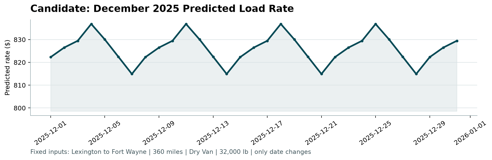

# Freight Rate Prediction: Report

## The problem

The goal is to predict `posted_rate` for truckload loads. The labeled data (`train_test.csv`) has 48,000 loads from January 1 to October 31, 2025. The loads I have to predict (`validation.csv`, 12,000 rows) are all from November and December 2025. So this is a forecasting problem more than a plain regression problem: the model only ever sees the past and is judged on the future. That shaped most of my decisions.

## What I found in the data

Distance explains most of the price (correlation 0.91 with the rate), so I mostly worked in rate per mile. Rate per mile goes down with distance, from about $2.74 on loads under 250 miles to $1.91 on loads over 2,000 miles. Equipment matters too. Dry Van is the cheapest at around $2.05/mile, then Flatbed ($2.22), then Reefer ($2.31).

Data-quality issues, and what I did about each one:

- **Negative weights.** 292 training rows and 145 validation rows have negative weights. They mirror the normal range exactly, including -47,500 where the normal cap is 47,500, so I read them as sign errors and took the absolute value.
- **Missing values.** About 0.6% of rows have no weight and 0.8% have no market index. I filled weight with the training median and market index with that day's average, since it barely changes within a day.
- **Label outliers.** 677 rows (1.4%) have a rate per mile about 3 times or about 0.2 times the typical value for their equipment and distance. There is a clean gap around them: nothing sits between 0.5x and 0.7x or between 1.5x and 2x of typical. That looks like entry errors, not real expensive or cheap loads. I dropped them from training. I kept them in the test scores, though, because the real validation labels probably have them too.
- **Coordinates.** The coordinates are unreliable. Boston sits at latitude 39.3, and Boston and Providence are both clipped to longitude -69.5. Each city has one fixed coordinate, so they still work as an identifier, but I rely on city names and distance first.
- **Unseen cities.** Eight cities in the validation set never appear in training (Chicago, Charlotte, San Diego, Laredo and others). They touch 1,447 validation loads (12%), so the model has to handle routes it has never seen.

### quote_signal is not what it looks like

This was the most important finding. In some months `quote_signal` is almost exactly the rate per mile: in January, February, March, June and September, 98% of rows are within $0.10 of it. In April, May, July and October only about 16% are, and the correlation turns negative. August is somewhere in between. It flips by whole calendar months.

I can't check the validation months directly because they have no labels. What I could do is compare `quote_signal` with my baseline's estimate, which needs no labels. That gives a share of close rows of about 95% in the "good" months and 41% in the "bad" ones. For November and December it comes out at 54%, the same as August. So the validation period looks like the mixed August pattern, where `quote_signal` can't be trusted.

`market_index` has a similar problem. Its monthly average moves between 0.93 and 1.30 while rate per mile moves much less, and its correlation with rate per mile drops from 0.25 in January–August to almost zero in September–October.

## How I split and validated

I never split randomly. A random split would let the model learn from October to predict September, which it can't do in real life. I used two checks:

1. **Holdout:** train on January to August, test on September to October. Fill values and outlier removal are fitted on the training part only.
2. **Monthly backtest:** for each month from June to October, train on all earlier months and test on that month. This shows how stable each model is when the market changes, which a single split can hide.

I also ran an unseen-city check: I hid 8 random cities from training and scored only the test loads that touch them.

`score.py` doesn't compute an accuracy metric, so I used mean absolute error (MAE, in dollars) and mean absolute percentage error (MAPE). I report them on all test rows and on "clean" rows with the label outliers removed.

## Models

First I built a baseline anyone could defend: the median rate per mile for the lane and equipment (if the lane has at least 5 loads), otherwise for the equipment and distance band, multiplied by distance. Any model has to beat this to be worth it.

The main model is gradient-boosted trees (scikit-learn's `HistGradientBoostingRegressor`, the same idea as LightGBM, with no system dependencies). It predicts rate per mile, which worked better than predicting the rate or its log. The features are pickup and delivery city (as categories), equipment, distance, log distance, weight, day of week and the city coordinates.

I left out month and day-of-year on purpose. November and December don't exist in the training data, so a tree would just treat them like October. I also left out `market_index` and `quote_signal`, for the reasons above. The backtest shows why:

| Test month | Baseline | GBM with market features | GBM without (final) |
|---|---|---|---|
| June | $150 | $80 | $148 |
| July | $93 | $36 | $65 |
| **August** | $82 | $96 | **$42** |
| September | $80 | $92 | $45 |
| October | $78 | $63 | $40 |

*MAE on clean rows, training on all earlier months.*

With market features the model does great in some months and worse than the baseline in others. It depends on whether `quote_signal` happens to be accurate that month. In August, the month that looks like November and December, it has more than twice the error. The model without them is consistent from July on.

## Results

Holdout (train Jan–Aug, test Sep–Oct):

| | Baseline | Final model |
|---|---|---|
| All test rows (9,523) | $135 / 6.0% | **$99 / 4.4%** |
| Clean rows (9,379) | $80 / 3.5% | **$43 / 1.8%** |
| Unseen cities (1,718) | $92 / 4.1% | **$56 / 2.5%** |

Most of the error on "all rows" comes from the label outliers. No model can predict those, so I'd expect the real validation score to look more like the first row than the second.

For the final predictions I retrained on all 47,323 clean rows (January to October) and predicted the 12,000 validation loads. Both output files pass `score.py`.

## December chart

The route is fixed (Lexington to Fort Wayne, 360 miles, Dry Van, 32,000 lb) and only the date changes. Since the model doesn't use the market features, the only thing that changes with the date is the day of the week. So the chart is a flat level with a weekly pattern, between $815 and $837. The weekly pattern is real: midweek loads cost about 2.5% more per mile than Sunday loads in the training data. The level also matches history. Recent Dry Van loads on this lane were between about $780 and $865.

## Limitations and next steps

- **Sudden market moves.** The model can't see them. June is the clear example: rates jumped that month and both the baseline and my model were off by about $150. If there were a market signal that stays reliable over time, it would be the first thing I'd add.
- **quote_signal might be the answer in some months.** If Spotter knows when it's accurate, a model could use it only then. With what I have, that's a guess I wasn't willing to make.
- **Tuning.** I didn't tune much. The gain from dropping the bad features was much bigger than anything tuning would give, and I preferred a model I can explain.
- **Missing labels in the validation period.** If some labeled November data were available, I'd use it to confirm the August comparison before trusting it fully.
